 

 

## ⚡ About Me

I'm Emmanuel, a **full stack engineer**, **AI/ML engineer** and **creative developer** based in Ghana. I build complete products end to end — the API and database, the AI layer, and an interface people genuinely enjoy using.

I'm not satisfied with things that just work; I want them to feel good too: smooth motion, intentional typography, considered interactions. Design and engineering aren't separate disciplines for me — they're the same craft seen from two angles, and AI is now part of both.

Much of my recent work is AI built for Ghanaian users: support agents that understand Twi, Ga, Ewe and Pidgin, voice and USSD ordering for people without smartphones, and mobile-money payments wired directly into the flow.

- 🗣️ Building **Helply** — open-source customer support that speaks Ghanaian languages and reads your logs (Gemma 4)
- 📞 Building **Maame** — voice- and USSD-first commerce: an AI market-woman takes orders in Twi and collects MoMo payments
- 🧠 Shipped **Keel** — a focus and time tracker with an on-device ML model that learns how long your tasks really take
- 🌐 Exploring **3D on the web** with Three.js and Blender, bringing depth to experiences most sites never attempt
- 💬 Ask me about LLM agents, structured output, Node/TypeScript backends, motion design, or multilingual AI
- 🎯 Open to **full stack**, **AI/ML engineering** and **creative developer** roles

 

## 🎯 What I Do

<table align="center">
<tr>
<td align="center" width="25%" valign="top">

### 💻 Full Stack

Next.js · React · TypeScript 
Node.js · Express APIs 
PostgreSQL · Prisma · Supabase 
Auth, payments & deployment

</td>
<td align="center" width="25%" valign="top">

### 🤖 AI Engineering

LLM agents & tool use 
RAG over company docs 
Speech (ASR / TTS) & translation 
Structured output & prompt design

</td>
<td align="center" width="25%" valign="top">

### 🧠 Machine Learning

On-device models 
Training & evaluation 
Open-weight models (Gemma) 
Data pipelines in Python

</td>
<td align="center" width="25%" valign="top">

### 🎨 Creative Dev & Design

UI/UX & design systems 
Wireframing & prototyping 
Motion & scroll animation 
3D web experiences

</td>
</tr>
</table>

 

## 🛠️ Tech Stack

**Languages**

**Frontend**

**Backend & Infrastructure**

**AI & Machine Learning**

**Motion, Animation & 3D**

**Design Suite**

 

## 🚀 Featured Projects

<table>
<tr>
<td width="50%" valign="top">

### 🌱 [FarmConnect Ghana](https://github.com/Cloudregh/farmconnect-ghana)
An AI-powered agricultural marketplace connecting Ghanaian farmers directly with buyers, complete with an AI farming advisor, seller dashboard, and WhatsApp checkout.

`React` `TypeScript` `Tailwind CSS` `Shadcn/Radix`

**What I solved:** designing for low-bandwidth mobile users and meeting them on the channel they already use (WhatsApp) instead of forcing a payment flow they don't trust.

</td>
<td width="50%" valign="top">

### 👠 [Velvet Steps](https://github.com/Cloudregh/Velvet-Steps)
A luxury e-commerce landing page for an exclusive footwear boutique, built around elegant typography, micro-animations, and a premium shopping feel.

`React 19` `Vite` `Tailwind CSS 4`

</td>
</tr>
<tr>
<td width="50%" valign="top">

### 📱 [iPhone 15 Pro Clone](https://github.com/Cloudregh/iphone)
A pixel-precise, scroll-animated recreation of Apple's iPhone 15 Pro site, featuring a custom video carousel and GSAP ScrollTrigger animations.

`React 19` `GSAP` `ScrollTrigger` `Tailwind CSS`

</td>
<td width="50%" valign="top">

### 🔍 [CodeAudit AI](https://github.com/Cloudregh/codeaudit-ai)
An AI-powered tool that generates instant code quality reports for any public GitHub repository. Built for the Orion Build Challenge 2026.

`React` `Gemini AI` `Vercel Serverless` `GitHub API`

**What I solved:** designing prompts that return consistently parseable structured output, and keeping the whole analysis inside a serverless function's execution limits.

</td>
</tr>
<tr>
<td width="50%" valign="top">

### 📝 [Nexa Extension](https://github.com/Cloudregh/Nexa-Extension) (Contributor)
A simple app that helps students capture and organize notes from online lectures and videos.

`TypeScript`

</td>
<td width="50%" valign="top">

 

**More builds in progress.** 
I'm always shipping something new, check back often.

</td>
</tr>
</table>

 

## 📊 GitHub Stats

 

 

## 🧭 What I'm Working Toward

I'm deliberately moving up the stack, from using AI models to building them, currently working through the fundamentals of supervised learning, model evaluation, and deployment, with the goal of shipping an end-to-end ML project trained on Ghanaian agricultural data.

If you're working on something at the intersection of web engineering and applied AI, I'd like to hear about it.

 

## 📫 Let's Connect

I'm always open to interesting projects, collabs, or just talking shop about design, code, and where AI is taking both.

